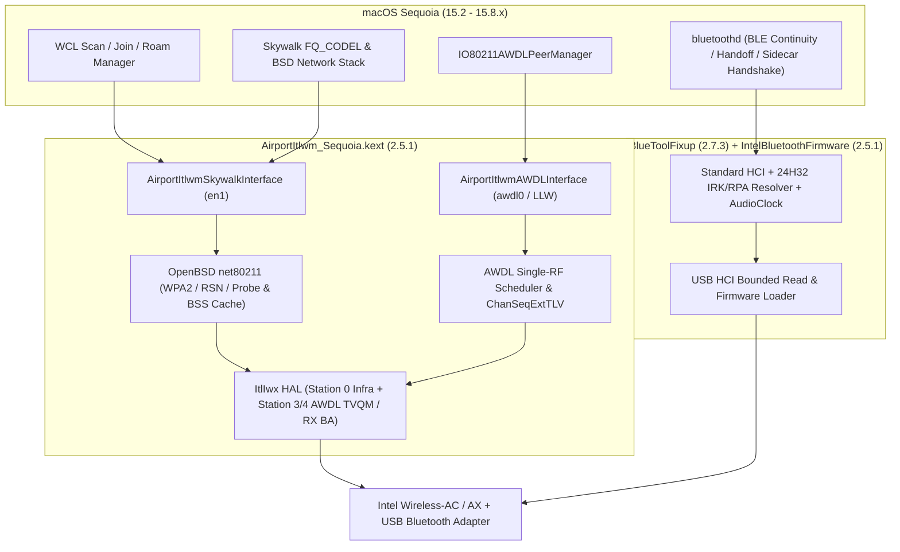

# AirportItlwm-Continuity

[](LICENSE)
[-black)](https://github.com/YPuddin-Neko/AirportItlwm-Continuity)
[](https://github.com/YPuddin-Neko/AirportItlwm-Continuity/actions/workflows/main.yml)
[](https://github.com/YPuddin-Neko/AirportItlwm-Continuity/releases)

专用于 **macOS Sequoia (`15.2` – `15.8.x`，Darwin `24.x`)** 的 Intel 无线与蓝牙连续互通驱动套件：
- **Wi-Fi 主驱动**：`AirportItlwm_Sequoia.kext`（`2.5.1`）— 直接运行在原生 Sequoia `IO80211Family` V2 / WCL 与 `IOSkywalkFamily` 协议栈之上（无需 OCLP 旧版 Wi-Fi 降级补丁），实现完整的 **AWDL / 低延迟连续互通栈**，并修复单射频网卡吞吐断崖、缓冲膨胀与隐藏网络接入。
- **蓝牙配套驱动**：`BlueToolFixup.kext`（`2.7.3`）+ `IntelBluetoothFirmware.kext`（`2.5.1`）— 补齐 Intel 蓝牙在 Sequoia 下的标准 HCI 扫描/广播一致性、Apple 同账号设备 BLE 私密随机地址（RPA / IRK）解析、音频时钟同步及 USB 中断队列防竞争补丁，保障隔空投送、随航、FaceTime 连续互通相机与接力的稳定握手。

---

## 致谢与上游溯源（Credits & Upstream Lineage）

本项目基于以下开源项目构建，完整保留上游 Git 提交历史与各自开源许可声明：

- **[OpenIntelWireless/itlwm](https://github.com/OpenIntelWireless/itlwm)** & **[IntelBluetoothFirmware](https://github.com/OpenIntelWireless/IntelBluetoothFirmware)**（原作者 [@zxystd](https://github.com/zxystd) 及全体贡献者）：提供 macOS Intel Wi-Fi 核心框架、HAL 抽象层与蓝牙固件加载机制（GPL-2.0）。
- **[laobamac/itlwm](https://github.com/laobamac/itlwm)**：提供 macOS Sequoia 原生 `IO80211Family` V2 / WCL 接口适配基底（本仓库保留其上游提交历史至 `738d4c6`）。
- **[acidanthera/BrcmPatchRAM](https://github.com/acidanthera/BrcmPatchRAM)** & **[Lilu](https://github.com/acidanthera/Lilu)** & **[MacKernelSDK](https://github.com/acidanthera/MacKernelSDK)**：`BlueToolFixup` 基底代码、内核补丁框架与编译 SDK 支持（BSD-3-Clause，详见 [LICENSE-BlueToolFixup.txt](bluetooth/LICENSE-BlueToolFixup.txt)）。
- **[hjgyuhuk/AirportItlwm15-intel-8265](https://github.com/hjgyuhuk/AirportItlwm15-intel-8265)**：Sequoia 独立 Clang 内核扩展构建脚本思路参考（GPL-2.0）。
- **[OpenBSD Project](https://www.openbsd.org/)**：`net80211` 802.11 协议栈及 `iwx` / `iwm` / `iwn` 无线硬件驱动实现（ISC / BSD 许可）。
- **Intel `iwlwifi` Linux Firmware**：Intel 无线网卡微码固件（详见 [iwlwifi-firmware-license](iwlwifi-firmware-license)）。

---

## 核心特性与技术改进

### 1. 原生 Sequoia AWDL / 低延迟连续互通栈（`AirportItlwm_Sequoia.kext`）
- **原生虚拟接口与低延迟队列架构**：完整实现对接原生 `IO80211AWDLPeerManager` 的 `AirportItlwmAWDLInterface`（`awdl0` / 低延迟媒体流通道）与 Sequoia Skywalk 队列封装（`IOSkywalkSequoiaQueues.h`），支持：
  - **隔空投送（AirDrop）** 双向发现与高速文件收发
  - **随航（Sidecar）** 无线显示扩展与低抖动媒体传输
  - **FaceTime 连续互通相机（Continuity Camera）** 稳定视频流传输
  - **接力（Handoff）** 与 **通用剪贴板（Universal Clipboard）**
- **单射频（Single-RF `sdb:0`）时分复用调度**：动态生成 `ChanSeqExtTLV`（TLV 32），协调基础设施 AP 信道与社交发现信道（`Ch 6 / 44 / 149`）的 `TimeEvent` 驻留窗口；避免多 MAC 共享同一硬件 PHY Binding 触发固件 UMAC 断言复位，并在实时媒体会话中维持统一频宽以消除切频卡顿。
- **独立低延迟数据通道**：为 AWDL 对端维护独立硬件 TVQM 发送队列（`Station 3/4`）以及分级接收重排超时（AWDL `40 ms` / LLW `8 ms`），防止单向延迟（OWRD）膨胀压低随航动态码率。

### 2. 基础设施 Wi-Fi（`en1`）吞吐与低延迟保障
- **消除单射频社交驻留导致的二秒掉速断崖**：将基础设施 `Station 0` 接收端 BlockAck 重排超时对齐上游 Linux `iwlwifi` 标准（`100 ms`），平滑跨越每秒 `16–64 ms` 的单射频 AWDL 社交驻留及常规二层重传，避免提前冲刷重排窗口引发乱序风暴与 TCP CUBIC 拥塞窗口腰斩（在 `Intel Wireless-AC 9560` 5 GHz `866.7 Mbps` 协商速率并存 AWDL 发现时，实测局域网持续下行达 `380–420 Mbps`）。
- **原生 Skywalk `FQ_CODEL` 队列背压协同**：严格维持 `outputStart` 中的 `ifq_is_oactive` 流控背压，将驱动层 `if_snd` 深度收敛至 `256`（单轮批量出队上限 `64`），确保由 macOS 内核 `FQ_CODEL` 负责多流公平排队与毫秒级延迟控制，杜绝缓冲膨胀阻塞下行反向 TCP ACK。
- **接收路径原地对齐与按需 DMA 同步**：对单引用 `MBUF_EXT` 接收簇原地完成 `ETHER_ALIGN`（2 字节）偏移对齐，省去每包二次簇分配与整帧拷贝；在 `AIRPORT_VTD` 模式下按实际合并包长度同步 DMA 缓冲，并在 `en1` 持续高速流量（`>= 1 Mbps`）时自动延缓非定向后台扫描切离主信道。

### 3. 隐藏 Wi-Fi（Hidden SSID）全频段接入支持
- **定向扫描直通硬件**：解除 `WCL_SET_ROAM_LOCK` 与 `WCL_REAL_TIME_MODE` 对主机扫描请求的误拦截，确保“其他网络…”及已保存隐藏热点的定向 SSID 扫描始终执行真实空口探测。
- **5 GHz UNII-3 分片续扫与被动转主动探测**：采用相邻子集完成间隔（`5.0s`）判定完整覆盖 `Ch 1–165` 全部信道；在 `CN` 等被动扫描监管域下为非 DFS 5 GHz 信道启用连续 `>= 110 TU` 驻留的 `PASSIVE2ACTIVE` 定向 Probe Request，并在后续空 SSID Beacon 中保留已探测到的真实 SSID 与 RSN IE。
- **扫描抢占、秒级开关重连与混合加密兼容**：移除 WCL 模式下初始化与扫描结束后的冗余 38 信道被动扫描，支持未关联状态原地更新私有 MAC（免固件重启）、`startWCLJoin` 抢占扫描及国家码去重，消除开关 Wi-Fi 或睡眠唤醒后的长时间重连等待；在 `WCL_SCAN_ABORT` 时同步下发 `IWX_SCAN_ABORT_UMAC` 清理固件扫描状态，兼容开放网络、WPA/WPA2 Personal 及 WPA2/WPA3 Transition 个人热点。

### 4. Sequoia 连续互通蓝牙配套增强（`BlueToolFixup` & `IntelBluetoothFirmware`）
- **标准 HCI 扫描/广播/连接指令族统一**：修复 Sequoia 下 Intel 控制器混用扩展与标准 HCI 谓词引发的 BLE 广播/扫描冲突，并为第三方 USB 蓝牙控制器补齐 LE 广播随机地址编程与默认 `1M PHY` 握手支持。
- **Apple 同账号设备 BLE 随机地址（RPA / IRK）解析与 APFS SSV 安全修补**：针对 `15.8.1 (24H32)` 原生 `bluetoothd`（内置严格 UUID 与指令上下文签名保护，非目标版本自动安全跳过），在进程启动阶段通过独立私有 COW `vm_map` 内存页注入全部 `bluetoothd` 补丁，彻底不修改 `disk3s4` 共享 UBC 缓存页（避免深度睡眠唤醒后重启 `bluetoothd` 触发 APFS SSV `EBADMSG 94` 校验崩溃），同时保持 `proc->p_csflags` 原样不变。
- **蓝牙音频时钟修正与 USB 中断完成防竞争**：修正本地音频连接句柄查找偏移，并在 `IntelBluetoothFirmware` 中保证 USB 中断读取边界与完成回调排空后再复用缓冲，消除高频 BLE 交互下的固件断连。

---

## 架构概览



---

## 环境要求与已知边界

| 项目 | 说明 |
|---|---|
| **操作系统** | **仅限 macOS Sequoia `15.2` – `15.8.x`**（代码硬性校验 `Darwin 24.2+`，**不支持** `15.0/15.1`、`macOS 14` 及更早版本，也**不支持 `macOS 26 Tahoe`**；AWDL 连续互通虚表与蓝牙 `bluetoothd` IRK 解析钩子基于 **`15.8.1 (24H32)`** 逆向核验，推荐在 `15.8.1` 下使用，且**请勿**叠加 OCLP 旧版 Wi-Fi 降级补丁） |
| **无线与蓝牙硬件** | `hal_iwx` 系列 Intel CNVi / PCIe 网卡及配套 USB 蓝牙（基准实测平台：`Intel Wireless-AC 9560 160MHz` `8086:02f0` + `QuZ-a0-jf-b0-68.ucode` 与 `8087:0aaa` 蓝牙；同架构 `9260 / 9462 / AX200 / AX201 / AX210 / AX211` 共享 `hal_iwx` 通道） |
| **前置依赖** | `BlueToolFixup.kext` 依赖 `Lilu.kext`（建议 `1.7.0+`）先行加载 |
| **SMBIOS 与账户** | 随航、接力与 FaceTime 连续互通相机需使用支持对应特性的 Mac SMBIOS 机型并登录有效 Apple ID |
| **无线加密支持** | 支持开放网络、WPA/WPA2-PSK、WPA2/WPA3-Transition（自动协商 WPA2-PSK）及 802.1X 企业网络；内核 `net80211` 暂未内置纯 WPA3-SAE（WPA3-Only）握手 |

---

## OpenCore 安装步骤

1. 从 [Releases](https://github.com/YPuddin-Neko/AirportItlwm-Continuity/releases) 下载最新 `v2.5.1` 驱动组件包：
   - `AirportItlwm_Sequoia.kext`（`2.5.1`）
   - `BlueToolFixup.kext`（`2.7.3`）
   - `IntelBluetoothFirmware.kext`（`2.5.1`）
2. 将上述 Kext 放入 `EFI/OC/Kexts/`（确保 `Lilu.kext` 排在 `BlueToolFixup.kext` 之前），并在 `config.plist -> Kernel -> Add` 中按顺序配置：
   - `Lilu.kext`
   - `BlueToolFixup.kext`（`MinKernel`: `24.2.0`）
   - `IntelBluetoothFirmware.kext`（`MinKernel`: `24.2.0`，**不要**同时加载旧版 `IntelBluetoothInjector.kext` 或 `IntelBTPatcher.kext`）
   - `AirportItlwm_Sequoia.kext`（`MinKernel`: `24.2.0`，`MaxKernel`: `24.99.99`，**不要**同时加载其他 `itlwm.kext` / `AirportItlwm.kext`）
3. 保存配置并重启 macOS；若此前更换过无线驱动导致网络服务重复，可运行 `sudo python3 tools/repair-network-service.py` 检查并修复 `en1` 主服务绑定。

---

## 本地编译与单元测试

### 编译步骤

```bash
git clone https://github.com/YPuddin-Neko/AirportItlwm-Continuity.git
cd AirportItlwm-Continuity

# 拉取指定版本的 MacKernelSDK
git clone https://github.com/acidanthera/MacKernelSDK.git
git -C MacKernelSDK checkout 3f750085caa17ec3a7880f11c11bf4f48cd6a164

# 1. 编译 Wi-Fi 驱动（产物位于 build/Sequoia-Release/AirportItlwm_Sequoia.kext）
python3 scripts/build-sequoia.py --configuration Release --jobs 4

# 2. 编译蓝牙配套驱动（脚本会自动拉取固定版本的上游源码归档并应用补丁）
python3 scripts/build-bluetooth.py bluetool --configuration Release --jobs 4
python3 scripts/build-bluetooth.py firmware --configuration Release --jobs 4
```

### 运行测试套件

仓库内置 81 套基于 AddressSanitizer / UndefinedBehaviorSanitizer 的隔离主机测试套件，覆盖 AWDL 同步与单射频调度、LLW 重排窗口、WCL 隐藏热点状态机、`ItlIwx` 收发路径以及蓝牙 HCI / IRK 地址解析逻辑：

```bash
python3 scripts/run-tests.py --jobs 4
```

---

## 目录结构

```text
├── AirportItlwm/              # Sequoia WCL 主控制器、Skywalk 桥接与 awdl0 连续互通接口
├── bluetooth/
│   ├── BlueToolFixup/         # Sequoia 标准 HCI、24H32 IRK/RPA 地址解析与音频时钟补丁模块
│   ├── patches/               # 针对固定版本 BrcmPatchRAM 与 IntelBluetoothFirmware 的补丁
│   └── LICENSE-BlueToolFixup.txt
├── include/                   # IO80211 / Skywalk / macOS 15 协议头与 HAL 抽象接口
├── itl80211/                  # OpenBSD net80211 协议栈与 XNU mbuf 适配层
├── itlwm/                     # Intel iwlwifi 固件资源与 hal_iwx 硬件调度层
├── scripts/
│   ├── build-sequoia.py       # AirportItlwm_Sequoia.kext (2.5.1) 构建脚本
│   ├── build-bluetooth.py     # BlueToolFixup (2.7.3) & IntelBluetoothFirmware (2.5.1) 构建脚本
│   ├── build-intel-privacy.py # 24H32 bluetoothd IRK/RPA 补丁镜像生成器
│   └── run-tests.py           # 并行隔离单元测试运行器
├── tests/                     # Wi-Fi 与蓝牙全量 ASan/UBSan 回归测试套件
└── tools/                     # AWDL 链路实测、轨迹回放与网络服务修复工具
```

---

## English Summary

**AirportItlwm-Continuity (`v2.5.1`)** is a native Continuity Wi-Fi and Bluetooth kernel extension suite for **macOS Sequoia (`15.2` – `15.8.x`, Darwin `24.x`, `x86_64`; verified on `15.8.1 / 24H32`, macOS 26 Tahoe not supported)** without OCLP legacy Wi-Fi downgrades:

- **`AirportItlwm_Sequoia.kext` (`2.5.1`)**: Built on [OpenIntelWireless/itlwm](https://github.com/OpenIntelWireless/itlwm) and [laobamac/itlwm](https://github.com/laobamac/itlwm), adding native `awdl0` Continuity & low-latency media scheduling (AirDrop, Sidecar, Continuity Camera, Handoff), `100 ms` `Station 0` RX BA reorder aging, strict Skywalk `FQ_CODEL` backpressure, in-place `ETHER_ALIGN` decapsulation, and full 2.4/5 GHz Hidden SSID join support.
- **`BlueToolFixup.kext` (`2.7.2`) & `IntelBluetoothFirmware.kext` (`2.5.1`)**: Built on [acidanthera/BrcmPatchRAM](https://github.com/acidanthera/BrcmPatchRAM) and [OpenIntelWireless/IntelBluetoothFirmware](https://github.com/OpenIntelWireless/IntelBluetoothFirmware), adding unified Sequoia standard HCI scan/advertising/connection predicates, `24H32` `bluetoothd` RPA/IRK address resolution across sleep/wake, audio clock lookup fixes, and bounded USB HCI interrupt completion draining.

---

## 开源许可（License）

- `AirportItlwm` 与 `IntelBluetoothFirmware` 相关代码遵循 **[GNU General Public License v2.0](LICENSE)**（GPL-2.0）发布。
- `bluetooth/BlueToolFixup/` 及 `BrcmPatchRAM` 衍生补丁遵循 **[BSD 3-Clause License](bluetooth/LICENSE-BlueToolFixup.txt)** 发布。
- `itl80211/` 及 `itlwm/hal_*` 中源自 OpenBSD 的代码保留其原始 **ISC / BSD** 版权与许可声明；内置无线固件遵循 **[Intel Firmware License](iwlwifi-firmware-license)** 分发。
