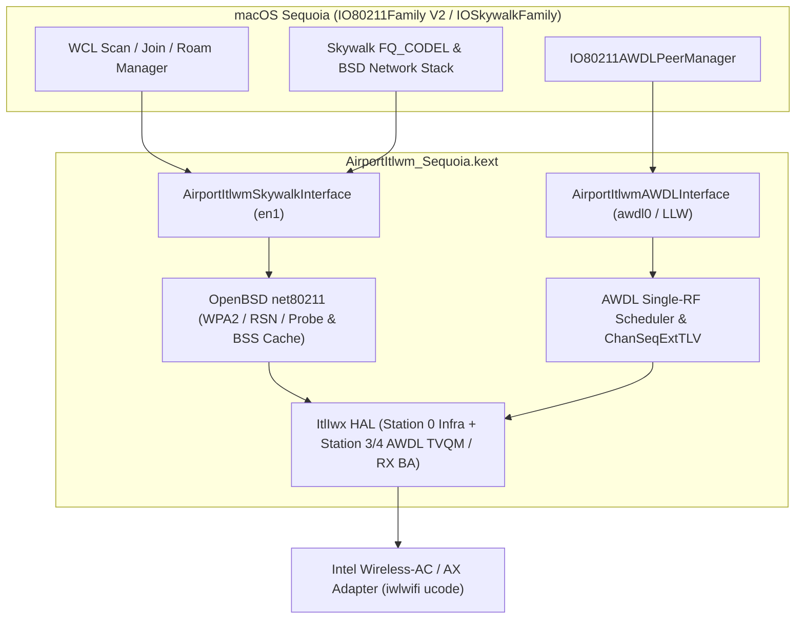

# AirportItlwm-Continuity

[](LICENSE)
[-black)](https://github.com/YPuddin-Neko/AirportItlwm-Continuity)
[](https://github.com/YPuddin-Neko/AirportItlwm-Continuity/actions/workflows/main.yml)
[](https://github.com/YPuddin-Neko/AirportItlwm-Continuity/releases)

专用于 **macOS Sequoia (`15.2` – `15.8.x`，Darwin `24.x`)** 的 Intel 无线网卡内核扩展驱动（`AirportItlwm_Sequoia.kext`）。本项目直接运行在原生 Sequoia `IO80211Family` V2 / WCL 与 `IOSkywalkFamily` 协议栈之上（无需使用 OCLP 回退旧版 Broadcom Wi-Fi 框架），重点补齐了 **AWDL / LLW 连续互通子系统**（隔空投送、随航、FaceTime 连续互通相机、接力、通用剪贴板），并针对单射频 Intel 网卡的基础设施 Wi-Fi 吞吐、队列延迟及隐藏热点接入进行了深度修复。

---

## 致谢与上游溯源（Credits & Upstream Lineage）

本项目基于以下开源项目的成果构建，并完整保留了上游 Git 提交历史与许可声明：

- **[OpenIntelWireless/itlwm](https://github.com/OpenIntelWireless/itlwm)**（原作者 [@zxystd](https://github.com/zxystd) 及全体贡献者）：提供 macOS Intel Wi-Fi 驱动核心架构、HAL 抽象层与固件加载实现（GPL-2.0）。
- **[laobamac/itlwm](https://github.com/laobamac/itlwm)**：提供 macOS Sequoia 原生 `IO80211Family` V2 / WCL 接口适配基底（本仓库保留其上游提交历史至 `738d4c6`）。
- **[hjgyuhuk/AirportItlwm15-intel-8265](https://github.com/hjgyuhuk/AirportItlwm15-intel-8265)**：Sequoia 独立 Clang 内核扩展构建脚本思路参考（GPL-2.0）。
- **[OpenBSD Project](https://www.openbsd.org/)**：`net80211` 802.11 协议栈及 `iwx` / `iwm` / `iwn` 无线硬件驱动实现（ISC / BSD 许可）。
- **Intel `iwlwifi` Linux Firmware**：Intel 无线网卡微码固件（详见 [iwlwifi-firmware-license](iwlwifi-firmware-license)）。
- **[acidanthera/MacKernelSDK](https://github.com/acidanthera/MacKernelSDK)**：macOS 内核扩展编译头文件与符号支持。

---

## 核心特性与技术改进

### 1. 原生 Sequoia AWDL / 低延迟连续互通栈
- **原生虚拟接口与低延迟队列架构**：完整实现对接原生 `IO80211AWDLPeerManager` 的 `AirportItlwmAWDLInterface`（`awdl0` / 低延迟媒体流通道）与 Sequoia Skywalk 队列封装（`IOSkywalkSequoiaQueues.h`），支持：
  - **隔空投送（AirDrop）** 双向发现与高速文件收发
  - **随航（Sidecar）** 无线显示扩展与低抖动媒体传输
  - **FaceTime 连续互通相机（Continuity Camera）** 稳定视频流传输
  - **接力（Handoff）** 与 **通用剪贴板（Universal Clipboard）**
- **单射频（Single-RF `sdb:0`）时分复用调度**：
  - 针对单射频 Intel CNVi / PCIe 网卡，动态生成 `ChanSeqExtTLV`（TLV 32），在基础设施 AP 信道与社交发现信道（`Ch 6 / 44 / 149`）之间协调 `TimeEvent` 驻留窗口。
  - 避免不同 MAC 角色共享同一硬件 PHY Binding 触发 `QuZ` 等固件 UMAC 异步断言复位，并在实时音视频会话期间维持统一信道宽度，消除宽窄频切换造成的秒级卡顿。
- **独立低延迟数据通道**：为 AWDL 对端维护独立硬件 TVQM 发送聚合队列（`Station 3/4`）以及分级的接收重排超时窗口（AWDL `40 ms` / LLW `8 ms`），防止单向延迟（OWRD）膨胀压低随航动态码率。

### 2. 基础设施 Wi-Fi（`en1`）吞吐与低延迟保障
- **消除单射频社交驻留导致的二秒掉速断崖**：将基础设施 `Station 0` 硬件接收端 BlockAck 重排超时对齐上游 Linux `iwlwifi` 标准（`100 ms`），使 `en1` 平滑跨越每秒 `16–64 ms` 的单射频 AWDL 社交驻留及常规 AP 二层重传，避免提前冲刷重排窗口引发乱序风暴与 TCP CUBIC 拥塞窗口折半（在 `Intel Wireless-AC 9560` 5 GHz `866.7 Mbps` 协商速率并存 AWDL 发现时，实测局域网持续下行达 `380–420 Mbps`）。
- **原生 Skywalk `FQ_CODEL` 队列背压协同**：严格维持 `outputStart` 中的 `ifq_is_oactive` 流控背压，将驱动层 `if_snd` 深度收敛至 `256`（单轮批量出队上限 `64`），确保由 macOS 内核 `FQ_CODEL` 负责多流公平排队与毫秒级延迟控制，消除兆字节级 FIFO 缓冲膨胀（Bufferbloat）对下行反向 TCP ACK 的阻塞。
- **接收路径原地对齐与按需 DMA 同步**：对单引用 `MBUF_EXT` 接收簇原地完成 `ETHER_ALIGN`（2 字节）以太网头偏移对齐，省去每包二次簇分配与整帧拷贝；在 `AIRPORT_VTD` 模式下按实际合并包长度同步 DMA 缓冲，并在 `en1` 存在持续高速流量（`>= 1 Mbps`）时自动延缓非定向后台扫描切离主信道。

### 3. 隐藏 Wi-Fi（Hidden SSID）全频段接入支持
- **定向扫描直通硬件**：解除 `WCL_SET_ROAM_LOCK` 与 `WCL_REAL_TIME_MODE` 对主机扫描请求的误拦截（两者仅作用于固件自主漫游与省电策略），确保“其他网络…”及已保存隐藏热点的定向 SSID 扫描始终执行真实空口探测。
- **5 GHz UNII-3 分片续扫与被动转主动探测**：采用基于相邻子集完成间隔（`5.0s`）的分片扫描续接判定，完整覆盖 `Ch 1–165` 全部信道子集；在 `CN` 等将 5 GHz 标记为被动扫描的监管域下，为非 DFS 信道启用连续 `>= 110 TU` 驻留的 `PASSIVE2ACTIVE` 定向 Probe Request，并在后续空 SSID Beacon 更新中保留已探测到的真实 SSID 与 RSN IE。
- **扫描抢占与混合加密兼容**：在 `WCL_SCAN_ABORT` 时同步向固件下发 `IWX_SCAN_ABORT_UMAC` 并清理扫描标志位，支持打开 Wi-Fi 菜单扫描期间立即点击加入隐藏热点；兼容开放网络、WPA/WPA2 Personal 及 WPA2/WPA3 Transition 个人热点。

---

## 架构概览



---

## 环境要求与已知边界

| 项目 | 说明 |
|---|---|
| **操作系统** | **仅限 macOS Sequoia `15.2` – `15.8.x`**（代码硬性校验 `Darwin 24.2+`，**不支持** `15.0/15.1`、`macOS 14` 及更早版本，也**不支持 `macOS 26 Tahoe`**；AWDL 连续互通私有虚表与偏移基于 `15.8.1 (24H32)` 逆向核验，建议使用 `15.8.x`，且**请勿**叠加 OCLP 旧版 Wi-Fi 降级补丁） |
| **无线网卡** | `hal_iwx` 系列 Intel CNVi / PCIe 网卡（如 `Wireless-AC 9260 / 9462 / 9560`、`Wi-Fi 6 AX200 / AX201 / AX210 / AX211` 等；基准实测硬件为 `Intel Wireless-AC 9560 160MHz` + `QuZ-a0-jf-b0-68.ucode`）。更早期 `iwm` / `iwn` 型号仅保留编译兼容，未逐一实机验证连续互通时序 |
| **蓝牙配套** | 隔空投送发现、接力与随航握手依赖 BLE 广播，需在 OpenCore 中同时加载正常工作的 Intel 蓝牙驱动（`IntelBluetoothFirmware.kext` + `BlueToolFixup.kext`） |
| **SMBIOS 与账户** | 随航、接力与 FaceTime 连续互通相机需使用支持对应特性的 Mac SMBIOS 机型并登录有效 Apple ID |
| **无线加密支持** | 支持开放网络、WPA/WPA2-PSK、WPA2/WPA3-Transition（自动协商 WPA2-PSK）及 802.1X 企业网络；内核 `net80211` 暂未内置纯 WPA3-SAE（WPA3-Only）握手 |

---

## OpenCore 安装步骤

1. 从 [Releases](https://github.com/YPuddin-Neko/AirportItlwm-Continuity/releases) 下载最新 `AirportItlwm_Sequoia.kext`（或按下方说明自行编译）。
2. 将 `AirportItlwm_Sequoia.kext` 放入 `EFI/OC/Kexts/`，并在 `config.plist -> Kernel -> Add` 中启用：
   - `BundlePath`: `AirportItlwm_Sequoia.kext`
   - `ExecutablePath`: `Contents/MacOS/AirportItlwm`
   - `PlistPath`: `Contents/Info.plist`
   - `MinKernel`: `24.2.0`
   - `MaxKernel`: `24.99.99`
3. 确保未同时加载其他版本的 `itlwm.kext` 或 `AirportItlwm.kext`（避免 PCI 设备抢占冲突）。
4. 保存配置并重启 macOS；若此前更换过无线驱动导致网络服务重复，可运行 `sudo python3 tools/repair-network-service.py` 检查并修复 `en1` 主服务绑定。

---

## 本地编译与单元测试

### 依赖准备
- macOS 15+ 及 Xcode Command Line Tools（或完整 Xcode，提供 `clang++` 与 `ld`）
- Python `3.9+`
- 指定版本的 `acidanthera/MacKernelSDK`（固定提交 `3f750085caa17ec3a7880f11c11bf4f48cd6a164`）

### 编译步骤

```bash
git clone https://github.com/YPuddin-Neko/AirportItlwm-Continuity.git
cd AirportItlwm-Continuity

# 拉取指定版本的 MacKernelSDK
git clone https://github.com/acidanthera/MacKernelSDK.git
git -C MacKernelSDK checkout 3f750085caa17ec3a7880f11c11bf4f48cd6a164

# 编译 Release 版本（产物位于 build/Sequoia-Release/AirportItlwm_Sequoia.kext）
python3 scripts/build-sequoia.py --configuration Release --jobs 4

# 编译 Debug 版本并校验跨目标共享源码编译
python3 scripts/build-sequoia.py --configuration Debug --check-shared --jobs 4
```

### 运行测试套件

仓库内置 60+ 套基于 AddressSanitizer / UndefinedBehaviorSanitizer 的隔离主机测试套件，覆盖 AWDL 信道序列与同步选举、LLW 重排窗口、单射频时间事件调度、蓝牙共存策略、WCL 隐藏热点扫描状态机及 `ItlIwx` 收发路径：

```bash
python3 scripts/run-tests.py --jobs 4
```

---

## 目录结构

```text
├── AirportItlwm/
│   ├── AWDL/                  # AWDL 同步状态机、信道序列、无线电仲裁与低延迟重排组件
│   ├── WCL/                   # Sequoia IO80211Family V2 / WCL 扫描、关联与 Beacon 桥接
│   ├── AirportItlwmAWDLInterface.*        # awdl0 连续互通虚拟接口与低延迟通道实现
│   ├── AirportItlwmSkywalkInterface.*     # Skywalk 控制与扫描接口封装
│   └── AirportItlwmV2.*                   # 驱动主控制器与发送队列背压管理
├── include/                   # IO80211 / Skywalk / macOS 15 协议头与 HAL 抽象接口
├── itl80211/                  # OpenBSD net80211 协议栈与 XNU mbuf 适配层
├── itlwm/
│   ├── firmware/              # 压缩前后的 Intel iwlwifi 固件资源
│   └── hal_iwx/               # Intel 9000 / 22000 / AX 系列 HAL、AWDL 硬件调度与 BT-Coex
├── scripts/
│   ├── build-sequoia.py       # Sequoia 内核扩展独立构建脚本
│   ├── run-tests.py           # 并行隔离单元测试运行器
│   └── zlib_compress_fw.py    # 固件压缩生成脚本
├── tests/                     # ASan/UBSan 回归与单元验证套件
└── tools/                     # AWDL 链路实测、轨迹回放与网络服务修复工具
```

---

## English Summary

**AirportItlwm-Continuity** is an Intel Wi-Fi kernel extension (`AirportItlwm_Sequoia.kext`) built natively on Apple's `IO80211Family` V2 (WCL) and `IOSkywalkFamily` stack without OCLP legacy Wi-Fi downgrades, targeting **macOS Sequoia (`15.2` – `15.8.x`, Darwin `24.x`, `x86_64`)** (Continuity private `IO80211Family` vtables verified on `15.8.1 / 24H32`; macOS 26 Tahoe `Darwin 25.x` is not supported).

Built on top of [OpenIntelWireless/itlwm](https://github.com/OpenIntelWireless/itlwm) (`zxystd`) and [laobamac/itlwm](https://github.com/laobamac/itlwm) with full upstream Git commit history preserved, it adds:
- Native **`awdl0` Continuity & low-latency media stack** with single-RF time-event co-scheduling for **AirDrop, Sidecar, FaceTime Continuity Camera, Handoff, and Universal Clipboard** on `hal_iwx` adapters.
- **Infrastructure (`en1`) throughput and latency fixes**: `100 ms` `Station 0` RX BlockAck reorder aging across single-RF AWDL social dwells, strict `FQ_CODEL` backpressure (`ifq_is_oactive`), in-place `ETHER_ALIGN` RX decapsulation, and bulk-traffic background scan deferral.
- **Full 2.4 GHz / 5 GHz Hidden SSID discovery & join**, including `PASSIVE2ACTIVE` directed probing on passive regulatory channels, multi-subset UNII-3 scan continuation, and `IWX_SCAN_ABORT_UMAC` scan preemption.

---

## 开源许可（License）

- 驱动主体代码遵循 **[GNU General Public License v2.0](LICENSE)**（GPL-2.0）发布。
- `itl80211/` 及 `itlwm/hal_*` 中源自 OpenBSD 的代码保留其原始 **ISC / BSD** 版权与许可声明。
- 内置 Intel 无线固件遵循 **[Intel Firmware License](iwlwifi-firmware-license)** 分发。
